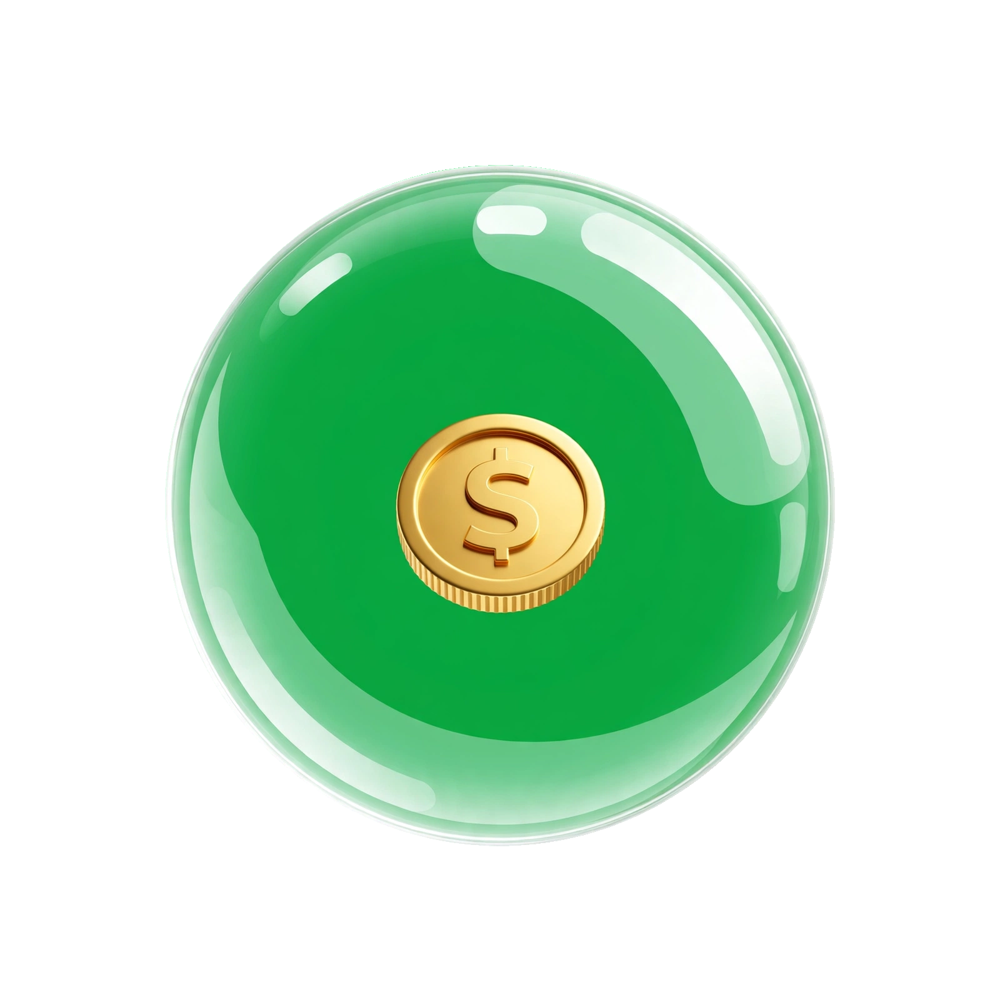

# token-saver v5.1 🌐 - With Target Language Selector

> Universal Chrome extension that saves 30-64% tokens by auto-translating any non-English language to ANY target language (EN default = most efficient). Works with Claude, ChatGPT & Codex.



### NEW in v5.1: Choose Target Language 🎯

You can now choose which language to translate TO - not just English:
- Popup → Target language dropdown → Select EN, ES, ZH, FR, DE, RU, JA, KO, AR, HI, etc.
- Bubble shows current target: EN, ES, ZH...
- Saved in chrome.storage, instant switch

### Installation

1. Download this folder
2. chrome://extensions → Developer mode ON → Load unpacked → select `token-saver` folder
3. Bubble appears, shows EN. Click popup to change target language.

### How it works

Detects non-English (>25% non-ASCII), protects code blocks, translates via Google free endpoint to your chosen target, sends to LLM. LLM replies in your original language via memory instruction.

Always set in Claude/ChatGPT:
```
Always reply in the user's original language (the language they wrote in before translation).
```

### License

MIT
